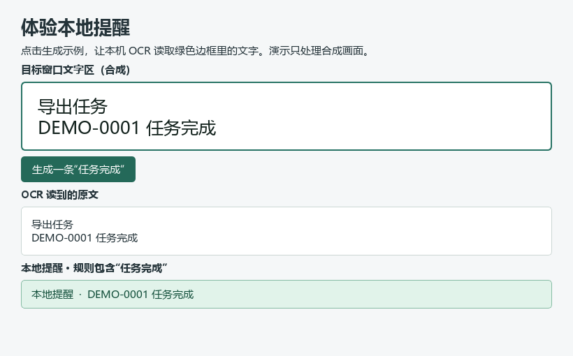

# CueScope

CueScope 在 Windows 上定时读取你圈选的窗口文字，遇到关心的词就提醒。你可以用它等候任务窗口出现“任务完成”，也可以只关注微信聊天里含指定关键词的普通文字。文字识别在本机运行。

[下载 Windows x64 便携包（v0.3.0 候选版）](https://github.com/LP-XXX/CueScope/releases/tag/v0.3.0) · [创建第一条提醒](QUICK_START.md) · [查看兼容性](VALIDATION.md) · [报告问题](https://github.com/LP-XXX/CueScope/issues/new/choose)

下载发行页 **Assets** 下的 `CueScope-0.3.0-win-x64.zip`（约 245 MiB），完整解压后运行 `CueScope.exe`。便携包已含 OCR 模型和运行环境，可直接使用本地记录与托盘提醒。飞书机器人是这个版本支持的远程渠道。0.3.1 候选源码新增 QQ 通知，可查看[QQ 接收设置](docs/QQ-NOTIFICATIONS.md)和[验证范围](VALIDATION.md)。

上图来自 0.3.1 开发版的“体验本地提醒”。画面使用人工生成的示例文字，原文和命中结果由实际本地 OCR 和短语规则生成。v0.3.0 用户可按快速入门用临时文档完成相同的练习。

## 适合哪些窗口

| 窗口中有什么 | 选什么模式 | 规则示例 |
| --- | --- | --- |
| 运行日志、下载或导出结果，每行一项 | 通用文字 · 逐行 | 一行包含“任务完成”时提醒 |
| 一个固定说明区，同一事项可能换行 | 通用文字 · 指定文本块 | 文本同时包含“同步”和“失败”时提醒 |
| 微信聊天里的普通文字气泡 | 微信聊天预设 | 包含“交付时间”，排除含“演练”的消息 |

每条规则只判断同一行、所选的单个文本块或同一气泡。可设置短语包含、整条相等、字符组合、任一或全部条件及排除项。在“活动记录”可以查看未命中的识别结果、命中与运行事件。

默认每 30 秒采样一次，可在 10–300 秒内调整。开始、恢复或重新校准后，第一帧只建立基线。电脑须唤醒且解锁，目标窗口须保持展开；遮挡时能否取得内容还与应用的渲染方式有关。采样之间短暂出现的内容可能遗漏。每种实际布局应先预览。[各场景验证结果](VALIDATION.md)

## 提醒与隐私

- **本地使用**只需选定窗口、圈选区域和一个规则。识别文字、命中记录以及启用保存的局部图片留在当前 Windows 用户的数据目录。
- **飞书提醒**会把命中内容发送给你配置的机器人。设置中可手动试发；飞书接受请求与手机看到消息分别验证。
- 升级会继续使用原 DealWatch 数据目录和凭据。回退应同时恢复兼容的配置备份。公开反馈请使用合成示例并移除标题、账号和凭据。[数据、升级与排障](QUICK_START.md)

## 开发与许可

项目使用 Python、PySide6 和本地 OCR。主程序与 Windows 采集组件使用独立的锁定环境。源码安装、离线测试和 PR 说明见[贡献指南](CONTRIBUTING.md)。维护者可查阅[发布流程](docs/RELEASING.md)；安全问题请按[安全报告方式](SECURITY.md)私下报告。

代码和自绘图标使用 MIT 许可证。模型、Qt、OCR 与其他依赖按各自条款分发。[MIT License](LICENSE) · [模型与第三方许可](THIRD_PARTY_NOTICES.md)
